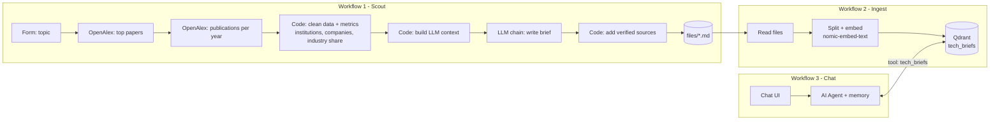

# Tech Scout

**A technology-scouting AI agent built with n8n, running fully locally.**

Tech Scout turns a technology name (e.g. *"solid-state batteries"*) into a structured technology brief: what it is, estimated maturity (TRL), key academic and industry players, publication trends and open challenges. The briefs are indexed in a vector database, and a chat agent answers questions about them with cited sources.

Everything runs locally in Docker: n8n for orchestration, Ollama for the LLM and embeddings, Qdrant as the vector store. No paid APIs.


---

## What it does

1. **Scout**: you enter a topic in a web form. The workflow pulls the most relevant recent papers and publication statistics from [OpenAlex](https://openalex.org), computes metrics, and has a local LLM write a technology brief grounded in that data.
2. **Ingest**: briefs are split into chunks, embedded and stored in Qdrant.
3. **Chat**: an AI agent answers questions such as *"Compare RAG and AI agents in terms of maturity and industry involvement"*, using retrieval over the briefs and citing which brief each answer comes from. It refuses when no brief covers the topic.

### Example brief (excerpt)

```markdown
# Solid-State Batteries - Technology Brief
## Maturity
Estimated TRL 6-7. Research has advanced to prototype and benchmark stages with
growing industry involvement, though widespread commercial deployment remains limited [2][6].

## Key players
Academic institutions: Justus-Liebig-Universität Gießen, Tsinghua University,
Karlsruhe Institute of Technology, University of Münster, ...
Companies: Nissan, Samsung Semiconductor, BASF
```

Full examples are in [`examples/`](examples/).

### Example chat

> **Q:** Compare RAG and AI agents in terms of maturity and industry involvement.
>
> | Aspect | RAG | AI Agents |
> |---|---|---|
> | Maturity (TRL) | 8 | 5–6 |
> | Industry involvement | 22% of top papers have industry authors | 14% of top papers have industry authors |
>
> RAG shows widespread commercial deployment, while AI agents show rapid academic growth but limited commercial integration.
> *(source: retrieval-augmented-generation.md, ai-agents.md)*

---

## Architecture



| Component | Role |
|---|---|
| **n8n** | Workflow orchestration, form and chat UI, AI agent |
| **Ollama** | Local LLM (Qwen3 4B Instruct) and embeddings (`nomic-embed-text`) |
| **Qdrant** | Vector store for the briefs |
| **OpenAlex API** | Open scholarly metadata: papers, abstracts, institutions, yearly counts |

---

## Design decisions and lessons learned

**The LLM never invents the data.** Paper lists, publication counts, institutions and industry share are computed in code from OpenAlex. The LLM only writes the narrative, and the source list with real DOIs is appended by code afterwards, so links cannot be hallucinated.

**Publication data underestimates commercial maturity.** The first version rated RAG at TRL 6, although it is widely deployed in products, because the model only saw academic papers. I added an industry signal: the share of top papers with at least one author from a company, plus the list of those companies. With an explicit TRL guide in the prompt, RAG moved to TRL 8 while solid-state batteries stayed at TRL 6–7, which matches reality much better.

**Citations need rules, not hope.** Small models ignore abstract instructions like "cite your sources". A concrete example in the prompt fixed in-text citations, and a separate rule stops the model from attaching paper citations to statistics that come from OpenAlex.

**Thinking models are too slow on CPU.** `qwen3:4b` now resolves to a *thinking* variant that spent 1,200+ tokens reasoning before writing (~9 tokens/s on CPU). Switching to the *instruct* variant cut generation time by roughly 3–4×.

**Small models are unreliable at deciding when to call tools.** The 4B agent sometimes answered without calling the retrieval tool at all, or retrieved one topic and filled in the other from its own knowledge. Listing the available briefs, requiring one search per technology and forbidding any facts not present in the tool results fixed most cases. A deterministic retrieval chain (always retrieve, then answer) is the fallback when reliability matters more than conversation memory.

---

## Limitations

- Briefs are based on academic literature only. Patents, market reports and news are not included yet.
- Yearly publication counts use OpenAlex full-text search, so they include papers that only mention the topic. They are useful for the **growth trend**, not as absolute numbers.
- The current year is always partial.
- A single TRL is a simplification for broad domains (e.g. software supply chain security covers many technologies at different maturity levels).
- A 4B local model is not fully consistent; the same question can occasionally produce a weaker answer.

## Future work

- Patent data as a second source (e.g. PatentsView, Lens.org)
- arXiv for very recent preprints
- Excel / Power BI export of the metrics across all topics (tech radar)
- Scheduled weekly re-scouting of all topics
- Larger model or API option for more reliable agent tool use

---

## Setup

**Requirements:** Docker with Docker Compose, ~6 GB free disk, 8+ GB RAM. No GPU needed.

```bash
git clone https://github.com/algub0312/tech-scout.git
cd tech-scout
mkdir -p files && sudo chown 1000:1000 files   # n8n runs as UID 1000

docker compose up -d
docker compose exec ollama ollama pull qwen3:4b-instruct-2507-q4_K_M
docker compose exec ollama ollama pull nomic-embed-text
```

1. Open **http://localhost:5678** and create a local n8n account.
2. Import the three workflows from [`workflows/`](workflows/) (*Workflows → Import from File*).
3. Create two credentials:
   - **Ollama**: base URL `http://ollama:11434`
   - **Qdrant**: URL `http://qdrant:6333`, no API key
4. In both OpenAlex HTTP nodes, set the `mailto` parameter to your own email (OpenAlex polite pool).

> Inside Docker, services reach each other by service name (`ollama`, `qdrant`), not `localhost`.

## Usage

1. **Scout**: open *Tech Scout – Collect*, click *Execute workflow* and enter a topic. The brief is saved to `files/<topic>.md` (about 1–2 minutes on CPU).
2. **Ingest**: run *Tech Scout – Ingest*. To re-ingest from scratch, delete the collection first:
   ```bash
   curl -X DELETE http://localhost:6333/collections/tech_briefs
   ```
3. **Chat**: open *Tech Scout – Chat* and click *Open chat*.

Qdrant dashboard: http://localhost:6333/dashboard

## Project structure

```
tech-scout/
├── docker-compose.yml
├── workflows/
│   ├── tech-scout-collect.json
│   ├── tech-scout-ingest.json
│   └── tech-scout-chat.json
├── examples/          # generated briefs
├── docs/              # screenshots
└── files/             # runtime output (git-ignored)
```
